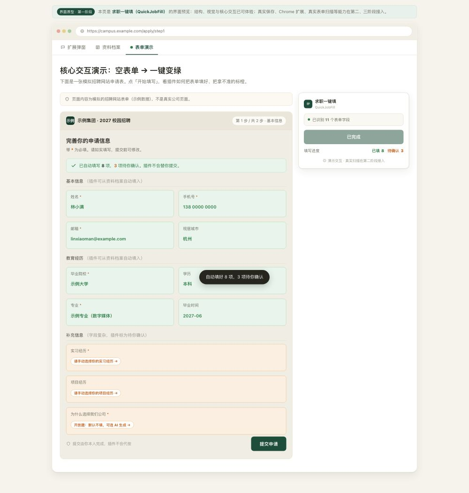

# QuickJobFill · 求职一键填

面向求职者的**本地优先**表单自动填写浏览器扩展。填一次个人资料，自动帮你填好各招聘网站的投递表单，本人确认后提交——**数据不出本机**。

当前状态：**界面原型（第一阶段）**。真实保存、Chrome 扩展安装、真实表单扫描、AI 字段识别将在第二阶段逐步接入。

---

## 项目用途

官网投递简历时，每家网站都要重复填姓名、电话、学历、经历……又烦又浪费时间。
求职一键填把「填一次，处处用」变成现实：

1. 维护一份**本地资料档案**（个人信息 / 教育 / 实习 / 项目经历）
2. 打开招聘网页，一键**自动填表**：能确定的填好标绿，拿不准的标橙待你确认
3. **由你本人确认后提交**——插件只填表、绝不代按提交，回应求职者最担心的信息泄露与误投

## 核心功能

| 功能 | 说明 | 当前状态 |
|------|------|----------|
| 个人资料档案 | 按分类整理求职信息，可搜索、可导出导入备份 | 界面已完成；真实保存/导入导出待接入 |
| 一键扫描自动填写 | 扫描页面字段，自动填入能确定的内容，复杂字段标橙待处理 | 交互演示完成；真实页面扫描待接入 |
| 确认与提交 | 绿/橙标记区分「已填」与「待你确认」，绝不自动提交 | 交互演示完成；真实提交流程待接入 |
| AI 字段识别（可选） | 配置 API Key 后可辅助识别五花八门的字段名；默认本地规则即可用 | 待接入 |

## 界面预览

**浏览器场景**：点工具栏插件图标，面板弹出帮你填表

**核心交互**：空表单 → 一键变绿（8 项自动填好，3 项标橙待确认）

> 预览图为界面原型演示，示例数据为虚构（非真实个人信息）。

## 运行方法

原型为**自包含单文件 HTML**，无需安装：

- **方式一（本地打开）**：下载 `求职一键填-页面原型.html`，用 Chrome / Edge / Safari 等浏览器直接打开即可体验。
- **方式二（在线预览）**：访问 GitHub Pages 演示链接（见仓库首页 About 区）。

真实浏览器扩展的安装方式（`chrome://extensions` 开发者模式加载）将在第二阶段提供。

## 复用的开源项目及许可证

- 本项目产品思路参考 [OpenJobAutofill](https://github.com/Br1an67/OpenJobAutofill)（[MIT License](https://github.com/Br1an67/OpenJobAutofill/blob/main/LICENSE)）——「本地资料 + 一键填表 + 本人确认」的隐私优先设计。当前原型为独立编写；后续实现若复用其代码，将保留原作者版权声明并遵循 MIT 许可证。
- 本项目自身采用 [MIT License](LICENSE)。

## 实际测试

已按验收清单对当前版本逐项实际测试（2026-10-25），**共 22 项全部通过**：

| 范围 | 项数 | 覆盖内容 |
|------|------|----------|
| 扩展弹窗场景 | 6 | 初始状态、弹窗开/关/重复操作、按钮反馈、视图跳转 |
| 资料档案 | 5 | 分类切换、输入编辑、保存/导出/导入反馈、刷新行为 |
| 表单演示 | 7 | 正常填充流程、重复点击保护、橙色定位、提交各状态、状态保留 |
| 页面整体 | 3 | 桌面/移动布局无溢出、控制台无错误、无僵尸按钮 |

真实能力（保存 / 扩展 / 扫描 / AI）尚未实现，**未标注为通过**。

## 已知限制

- 刷新后用户输入不保留（真实本地存储未接入，第二阶段 2.1）
- 表单演示为**模拟招聘页面**，非真实网站（真实扫描第二阶段 2.3）
- 提交为演示提示，无真实提交（第二阶段 2.4）
- 演示数据为虚构示例，非真实个人信息

## 路线图

- [x] 第一阶段：界面原型（弹窗场景 / 资料档案 / 表单演示 + 核心交互）
- [ ] 第二阶段 2.1：资料真实保存 / 导出导入
- [ ] 第二阶段 2.2：Chrome 扩展壳（开发者模式加载）
- [ ] 第二阶段 2.3：真实表单扫描自动填（本地规则）
- [ ] 第二阶段 2.4：绿/橙标记 + 定位 + 不自动提交（真实页面）
- [ ] 第二阶段 2.5：AI 可选字段识别（自备 API Key）
